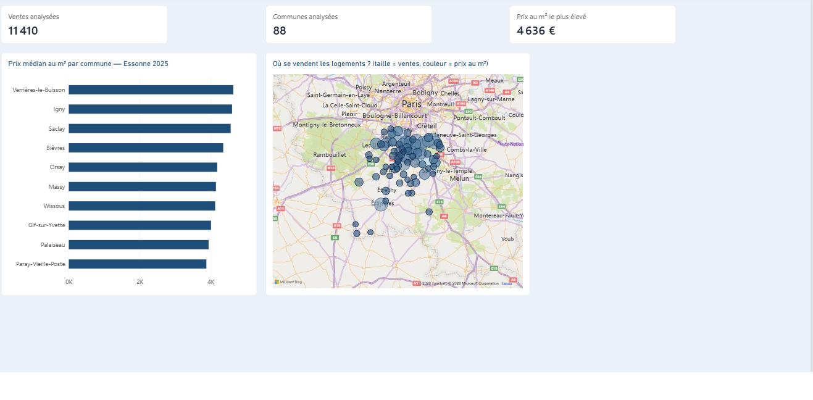

# Immobilier en Essonne : analyse des ventes 2025

Analyse du marché immobilier de l'Essonne (91) à partir des données publiques
**DVF** (Demandes de Valeurs Foncières) publiées par la DGFiP sur data.gouv.fr.



## Outils
- **DuckDB** et **SQL** : ingestion, contrôles qualité, agrégations (CTE)
- **Power BI** : tableau de bord interactif, mesures DAX, thème personnalisé
- **Linux (WSL2)**, **VS Code**, **Git / GitHub**

## Démarche
1. **Ingestion** du fichier officiel DVF 2025 de l'Essonne
2. **Contrôles qualité** : couverture temporelle, structure des données, valeurs aberrantes
3. **Correction d'un biais** : certaines ventes regroupent des dizaines de logements
   (ex. 2 ventes de 80 logements à Igny), ce qui gonflait le prix au m² (12 497 €/m² au lieu de 4 602 €/m²).
   Correction avec une CTE : une ligne par vente, ventes d'un seul logement uniquement.
   Sont aussi exclues les ventes mixtes (logement + local commercial, dont le prix couvre les deux)
   et les ventes portant sur plusieurs communes.
   Les prix aberrants sont écartés : moins de 500 €/m² (ventes à 1 €, cessions symboliques)
   ou plus de 15 000 €/m² (surface bâtie incohérente, ex. une maison de 4 m²).
4. **Export** des résultats en CSV et **visualisation** dans Power BI

## Principaux résultats (2025)
- 43 662 lignes, mais **17 625 ventes réelles** : une vente peut occuper plusieurs lignes
- **11 410 ventes** d'un seul logement analysées dans **88 communes** (au moins 30 ventes chacune)
- Prix médian au m² le plus élevé : **Verrières-le-Buisson (4 636 €/m²)**, suivie d'Igny, Saclay et Bièvres
- Les communes les plus chères sont au nord du département, près de Paris et du plateau de Saclay

## Fichiers du projet
| Fichier | Rôle |
|---|---|
| `exploration.sql` | Exploration et contrôles qualité |
| `correction.sql` | Prix au m² corrigé (CTE) |
| `export.sql` | Export des résultats pour Power BI |
| `resultats/prix_m2_communes.csv` | Résultats par commune |
| `immobilier-essonne.pbix` | Tableau de bord Power BI |
| `theme-bleu.json` | Thème Power BI personnalisé |

## Reproduire l'analyse
```bash
mkdir -p data/raw
wget -P data/raw https://files.data.gouv.fr/geo-dvf/latest/csv/2025/departements/91.csv.gz
duckdb < correction.sql
duckdb < export.sql
```
Puis ouvrir `immobilier-essonne.pbix` dans Power BI Desktop et cliquer sur **Actualiser**.

## Source
Données : [DVF géolocalisées, data.gouv.fr](https://www.data.gouv.fr/fr/datasets/demandes-de-valeurs-foncieres-geolocalisees/), Licence Ouverte 2.0
